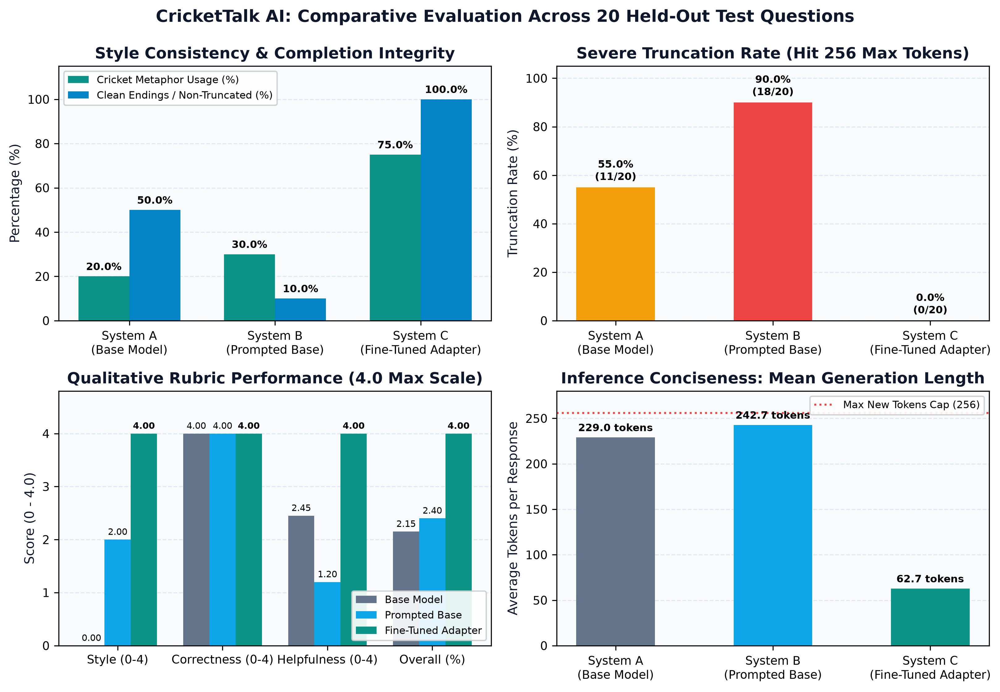

# 🏏 CricketTalk AI

### Fine-Tuning a Language Model to Answer Everyday Questions in Cricket Commentary Style


CricketTalk AI is an experimental AI project that fine-tunes a small open-weight language model to answer general, non-cricket questions in the style of cricket commentary while preserving factual correctness and practical usefulness.

Instead of answering a question in ordinary conversational language, the model uses cricket-inspired expressions, match situations, and commentary-style explanations to make everyday answers more engaging.

The project investigates whether fine-tuning can teach a model a distinctive response style and compares it with the original base model and a model guided by a cricket-commentary system prompt.

---

## 📌 Project Objectives

- Fine-tune a small language model using supervised fine-tuning.
- Teach the model to answer general questions using cricket commentary language.
- Use LoRA to reduce the number of trainable parameters.
- Compare the base model, prompted model, and fine-tuned model.
- Evaluate style consistency, correctness, helpfulness, and completeness.
- Publish the trained adapter on Hugging Face.
- Provide a chatbot interface for interacting with the model.

---

## ✨ Key Features

- **Cricket-style answers:** Everyday questions answered with cricket-inspired expressions.
- **Parameter-efficient fine-tuning:** LoRA adapter training instead of updating all model parameters.
- **Comparative evaluation:** Compare different model configurations using the same questions.
- **Interactive chatbot:** A Gradio-based interface for conversational interaction.
- **Reproducible workflow:** Training, evaluation, and project documentation.
- **Evaluation evidence:** Screenshots and reports documenting the implementation.

---

## 🖼️ Project Screenshots

### 1. Chatbot Interface
The chatbot provides an interface for asking questions and viewing model responses.


### 2. Trained Adapter
Evidence of the trained adapter files.


### 3. Hugging Face Model Repository
The published model repository contains the fine-tuned adapter and its configuration files.  
👉 [View the CricketTalk AI model on Hugging Face](https://huggingface.co/Hiteshilamakar23/crickettalk-ai-lora)


### 4. Model Comparison
Visual evidence from the model comparison experiments.


### 5. Evaluation Metrics
A visual summary of the evaluation metrics used in the experiments.



> **Note:** The screenshots document the project and its experiments. Refer to the evaluation results and reports for the actual measured scores and their interpretation.

---

## 🧠 Model and Fine-Tuning Approach

### Base Model
**`Qwen/Qwen2.5-0.5B-Instruct`**  
This compact instruction-tuned language model was selected because it can follow instructions, answer general questions, and fit the project's limited compute budget.

### Fine-Tuning Method
**Supervised Fine-Tuning (SFT) with Low-Rank Adaptation (LoRA)**  
The training process teaches the model to reproduce cricket-commentary-style answers using examples of questions and corresponding responses.

LoRA introduces small trainable matrices into selected model layers. Instead of updating every parameter of the original model, training focuses on the adapter parameters. This reduces training memory requirements and produces a smaller artifact that can be shared separately from the base model.

### Training Workflow
1. Select the `Qwen2.5-0.5B-Instruct` base model.
2. Prepare a dataset of general questions and cricket-style answers.
3. Validate the dataset structure and separate training, validation, and test examples.
4. Tokenize the examples into model inputs.
5. Configure LoRA and supervised fine-tuning.
6. Train the adapter using the available Google Colab compute.
7. Save the trained adapter and configuration.
8. Load the adapter alongside the original base model.
9. Generate answers to held-out test questions.
10. Compare the base, prompted, and fine-tuned configurations.

### Evaluation Configurations

| Configuration | Description |
| :--- | :--- |
| **Base model** | Original model without a cricket-style instruction |
| **Prompted model** | Original model instructed to use cricket commentary |
| **Fine-tuned model** | Base model combined with the trained LoRA adapter |

*The same held-out questions should be used across configurations to support a fair comparison.*

---

## 🛠️ Technology Stack

| Technology / Library | Purpose |
| :--- | :--- |
| **Python** | Main programming language |
| **PyTorch** | Tensor operations and model computation |
| **Hugging Face Transformers** | Loading the base model, tokenizer, and generating responses |
| **PEFT** | Applying and loading the LoRA adapter |
| **TRL** | Supervised fine-tuning utilities |
| **Datasets** | Preparing and managing training and evaluation datasets |
| **Accelerate** | Supporting model training and hardware configuration |
| **Gradio** | Building the interactive chatbot interface |
| **Pandas** | Organizing and analyzing evaluation results |
| **NumPy** | Numerical operations |
| **Matplotlib** | Creating evaluation charts, where used |
| **Scikit-learn** | Evaluation utilities, where used |
| **Pytest** | Automated tests, where implemented |
| **Google Colab** | Cloud notebook environment for training and experiments |
| **Hugging Face Hub** | Hosting and distributing the trained adapter |
| **Git and GitHub** | Version control and project documentation |

*The table describes the libraries used or planned in the project workflow. Check `requirements.txt` and the actual source files to confirm which dependencies are used by the final implementation.*

---

## 📂 Project Structure

```
CricketTalkAi/
│
├── app.py
├── requirements.txt
├── README.md
│
├── data/
│   ├── raw/
│   │   └── Training dataset files
│   ├── processed/
│   │   └── Processed dataset files
│   └── test/
│       └── Held-out evaluation data
│
├── notebooks/
│   └── CricketTalkai01 with model comparison.ipynb
│
├── src/
│   └── Training and supporting modules
│
├── tests/
│   └── Automated tests, where implemented
│
├── reports/
│   ├── AUDIT_SUMMARY.md
│   ├── CricketTalkAI_Interactive_Report.html
│   ├── CricketTalkAI_Submission_Report_Hitesh_Ilamkar.pdf
│   └── CricketTalkAI_Technical_Evidence_Report_Hitesh_Ilamkar.pdf
│
└── Screenshots/
    ├── Chatbot snapshot.png
    ├── Trained adapter.png
    ├── huggingFace snapshot.png
    ├── model_comparison.png
    └── model_comparison_metrics.png
```

*This is a documentation-oriented overview. Some directories may contain additional files, and the exact contents can vary. Refer to the repository for the current structure.*

---

## 🚀 Installation and Setup

### Prerequisites
- Python 3.10 or a compatible version supported by the installed dependencies.
- Git.
- Internet access for downloading the base model and dependencies.
- Sufficient RAM and disk space.
- A GPU is recommended for faster inference and fine-tuning.

### Step 1: Clone the Repository
```bash
git clone https://github.com/hitesh358-str/CricketTalkAi_-finetuned-model.git
cd CricketTalkAi_-finetuned-model
```

### Step 2: Create a Virtual Environment

**Windows:**
```powershell
python -m venv .venv
.venv\Scripts\activate
```

**Linux / macOS:**
```bash
python3 -m venv .venv
source .venv/bin/activate
```

### Step 3: Install Dependencies
```bash
python -m pip install --upgrade pip
pip install -r requirements.txt
```
*For GPU training, install a PyTorch build compatible with the selected CUDA environment before running the training notebook.*

### Step 4: Launch the Chatbot
If `app.py` contains the Gradio application and its required model-loading code, run:
```bash
python app.py
```
Open the local URL printed by Gradio in the terminal.

> **Important:** The application must have access to the base model and the correct adapter. If model loading requires Hugging Face authentication, configure your token securely using the supported login mechanism or an environment variable. Never commit access tokens to GitHub.

### Step 5: Run the Training or Evaluation Notebook
Open the notebook in Google Colab:  
👉 [Open CricketTalk AI Colab Notebook](https://colab.research.google.com/drive/1UxDdYKaS7W73orXmXE25Z5PGlXW0ptgg?usp=sharing)

Select a suitable runtime, mount Google Drive if required, and follow the notebook's documented cell order.

*Training is not required just to run inference if the trained adapter is already available and compatible with the selected base model.*

---

## 📊 Evaluation Methodology

The project compares three configurations:
1. The untouched base model.
2. The base model with a cricket-commentary system prompt.
3. The fine-tuned model with its LoRA adapter.

Evaluation should use held-out questions that were not used for training.

### Evaluation Dimensions
- **Style consistency:** Does the response use recognizable cricket-commentary language?
- **Correctness:** Are the factual claims accurate?
- **Helpfulness:** Does the answer provide useful, actionable information?
- **Completeness:** Does the response adequately answer the question?
- **Response quality:** Is the output coherent and free of obvious truncation?

A rubric-based evaluation can score each dimension using a consistent scale. Any aggregate percentage should be accompanied by the scoring method, sample size, and limitations.

*A style score is not the same as factual accuracy. A response can sound like cricket commentary and still contain incorrect information.*

See the `reports/` directory for the detailed reports and available evaluation evidence.

---

## 📈 Results and Limitations

The purpose of this experiment is to determine whether fine-tuning improves cricket-commentary style compared with prompt engineering alone, while preserving correctness and usefulness.

The final conclusions should be based on the saved evaluation outputs and verified scores. A small test set provides an initial comparison, not a guarantee of general performance.

Known limitations of a small fine-tuning experiment can include:
- Limited diversity in training examples.
- Inconsistent use of cricket terminology.
- Occasional incomplete or truncated responses.
- Trade-offs between stylistic expression and answer clarity.
- Limited statistical confidence from a small held-out test set.

Further work could expand the dataset, improve answer diversity, tune generation settings, and conduct a larger human-reviewed evaluation.

---

## 📄 Reports and Evidence

The repository includes reports describing the project, implementation, and evaluation evidence:

- **Submission report:** [`reports/CricketTalkAI_Submission_Report_Hitesh_Ilamkar.pdf`](reports/CricketTalkAI_Submission_Report_Hitesh_Ilamkar.pdf)
- **Technical evidence report:** [`reports/CricketTalkAI_Technical_Evidence_Report_Hitesh_Ilamkar.pdf`](reports/CricketTalkAI_Technical_Evidence_Report_Hitesh_Ilamkar.pdf)
- **Interactive report:** [`reports/CricketTalkAI_Interactive_Report.html`](reports/CricketTalkAI_Interactive_Report.html)
- **Audit summary:** [`reports/AUDIT_SUMMARY.md`](reports/AUDIT_SUMMARY.md)

Open the files directly from the `reports/` directory in this repository.

---

## 🔗 Project Links

- **GitHub repository:** [https://github.com/hitesh358-str/CricketTalkAi_-finetuned-model](https://github.com/hitesh358-str/CricketTalkAi_-finetuned-model)
- **Hugging Face model:** [https://huggingface.co/Hiteshilamakar23/crickettalk-ai-lora](https://huggingface.co/Hiteshilamakar23/crickettalk-ai-lora)
- **Google Colab notebook:** [https://colab.research.google.com/drive/1UxDdYKaS7W73orXmXE25Z5PGlXW0ptgg?usp=sharing](https://colab.research.google.com/drive/1UxDdYKaS7W73orXmXE25Z5PGlXW0ptgg?usp=sharing)

---

## 👨‍💻 Author

**Hitesh Ilamkar**

CricketTalk AI was developed as a fine-tuning and evaluation project to explore the relationship between language-model adaptation, prompt engineering, response style, and factual usefulness.

If you explore this project, please refer to the accompanying reports for the experiment details and measured results.
